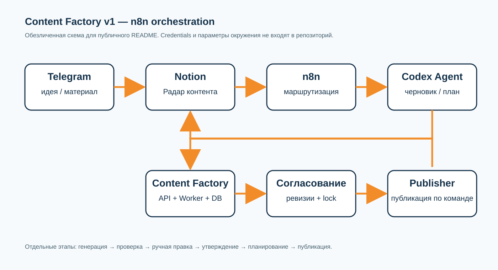

# Content Factory v1

Локальный MVP для подготовки, согласования и контролируемой публикации контента.

Проект решает повторяющуюся рабочую задачу: превращает идею, исходный материал или контент-план в проверяемый черновик публикации и проводит его через управляемый цикл ревизий, ручной правки и утверждения.

## Зачем нужен проект

Без единого контура контент проходит через разрозненные сообщения, таблицы и ручные копирования. Из-за этого теряются исходники, смешиваются версии, AI может перезаписать ручную правку, а утверждение текста легко спутать с разрешением на публикацию.

Content Factory разделяет эти этапы и сохраняет историю изменений.

## Что делает MVP

- принимает задание на публикацию или контент-план;
- передаёт структурированный контекст ИИ-агенту в Codex;
- формирует черновик поста или контент-плана;
- сохраняет результат со статусом `REVIEW`;
- поддерживает AI-корректировку по комментарию;
- сохраняет ручную правку отдельной ревизией;
- включает `MANUAL_LOCK`, чтобы AI не перезаписал ручную версию;
- обрабатывает ошибки и повторные попытки;
- отделяет утверждение от планирования и публикации;
- возвращает статус и результат в рабочий контур Notion.

## Как устроен контур

```text
Telegram
    ↓
n8n: приём идеи и маршрутизация
    ↓
Notion: Радар контента / Контент-планы
    ↓
n8n: передача задания
    ↓
Codex Agent: анализ источников и генерация результата
    ↓
Content Factory API → PostgreSQL ← Worker
    ↓
n8n: возврат результата и управление ревизиями
    ↓
Notion → отдельное утверждение → планирование → Telegram publisher
```

### Роли компонентов

- **Telegram** — быстрый вход для идей и рабочих материалов.
- **Notion** — интерфейс управления: карточки, статусы, комментарии, даты и ссылки.
- **n8n** — оркестрация обмена между Telegram, Notion, API и публикационным контуром.
- **Codex Agent** — обработка структурированных данных, исходников и правил проекта.
- **Content Factory API** — создание заданий, ревизий и переходов состояния.
- **PostgreSQL** — состояние заданий, пакетов и история ревизий.
- **Worker** — получение заданий и запуск обработки.
- **Telegram publisher** — отдельный контролируемый этап публикации.

## Рабочий сценарий

1. Идея приходит из Telegram или создаётся в Notion.
2. n8n создаёт или обновляет карточку в рабочей базе.
3. Из карточки передаются аудитория, проблема, главная мысль, источники, CTA и ограничения.
4. Codex Agent формирует черновик поста или контент-план.
5. Результат возвращается в Notion со статусом `На проверке` / `REVIEW`.
6. Влад может запросить AI-корректировку или изменить текст вручную.
7. Ручная версия сохраняется как новая ревизия и защищается `MANUAL_LOCK`.
8. Утверждение, планирование и публикация выполняются отдельными действиями.
9. После публикации Notion получает статус, дату и подтверждённую ссылку.

## n8n-сценарии

n8n используется как оркестратор связки Telegram, Notion, Content Factory и publisher. Рабочие workflow не публикуются в открытом репозитории: они содержат настройки конкретного окружения и показываются в проекте через обезличенные скриншоты и описание потоков.

Ключевые потоки:

- Telegram → Notion — приём идеи и создание карточки;
- Notion → Content Factory — передача контекста в обработку;
- Content Factory → Notion — возврат черновика и статуса;
- Notion → ревизия — AI-корректировка или ручная версия;
- утверждение → планирование → Telegram publisher;
- публикация → Notion — фиксация статуса и ссылки.

Конфигурации n8n остаются во внутреннем рабочем контуре и не являются частью публичного кода MVP.



## Локальный запуск

### Требования

- Windows или Linux;
- Docker Desktop / Docker Engine;
- Python 3.11+ для локальных тестов;
- Codex CLI для полного режима генерации.

### Запуск локального API и PostgreSQL

```powershell
docker compose -p content-factory-v1 -f automation\content-factory-v1\docker-compose.yml up -d --build
```

После запуска:

- API: `http://127.0.0.1:8765`;
- Swagger: `http://127.0.0.1:8765/docs`;
- PostgreSQL: `127.0.0.1:55432`.

### Локальные тесты

```powershell
python -m unittest discover -s automation\content-factory-v1\worker\tests -v
```

В последней проверенной версии успешно прошли 14 тестов Worker: генерация, схемы, ревизии, ручная блокировка, повторная обработка и защита источников.

### Остановка

```powershell
docker compose -p content-factory-v1 -f automation\content-factory-v1\docker-compose.yml stop
```

Команда `down -v` удаляет локальные данные базы и без отдельного решения не используется.

## Проверенные результаты

- локальный API и PostgreSQL запускаются отдельным контуром;
- Worker получает и обрабатывает задания;
- результат генерации сохраняется в `REVIEW`;
- AI-корректировка создаёт новую ревизию;
- ручная правка включает `MANUAL_LOCK`;
- повторная AI-корректировка после ручной правки блокируется;
- контент-план проходит отдельный цикл согласования;
- утверждение плана не создаёт публикации автоматически;
- публикация отделена от генерации и согласования.

## Границы MVP

MVP не является универсальной SMM-платформой. В текущую версию не входят масштабирование, аналитика эффективности публикаций, подключение новых каналов и полноценный self-service для внешних клиентов.

Production-интеграции с Notion, n8n и Telegram требуют собственных секретов и окружения. Секреты, токены, SSH-ключи и локальные конфигурации не входят в репозиторий.

## Проектный скилл

Инструкции для работы Claude Code с контентным контуром находятся в [`.agents/skills/content-production/SKILL.md`](.agents/skills/content-production/SKILL.md).

Скилл описывает источники, статусы, редакционные ограничения, правила подготовки публикаций, JSON-пакеты и проверку результата.

## Структура проекта

```text
automation/content-factory-v1/   API, Worker, схемы и тесты MVP
automation/n8n-workflows/        workflow интеграции и публикации
automation/telegram-publisher/   отдельный Telegram publisher
reports/                         примеры контентных пакетов и результатов
.agents/skills/                  проектный скилл
```

## Автор

Проект создан Владиславом Онищуком как рабочий инструмент для управления производством контента в консалтинговом агентстве.

